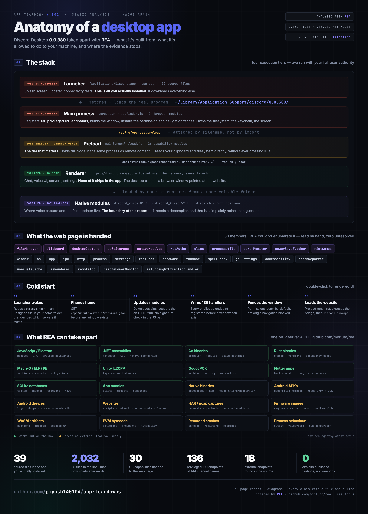

<div align="center">

# App Teardowns

### Understanding how real apps work — one PDF at a time.

**Pick an app. Read the PDF. Find out exactly how it's built, what it's allowed to do to your computer, and who it talks to — with a file and a line number behind every claim.**

[](https://github.com/morluto/rea)
[](#the-apps)
[](LICENSE)
[](LICENSE)
[](DISCLAIMER.md)

**[The apps](#the-apps) · [How these are made](#how-these-are-made) · [Reading a report](#reading-a-report) · [Do it yourself](#do-it-yourself) · [Coming next](#coming-next) · [FAQ](#faq)**

</div>

<br>

<a href="apps/discord/Discord-Desktop-Teardown.pdf"></a>

> [!IMPORTANT]
> Everything here is **static analysis of software already installed on a machine the analyst owns**,
> for interoperability research, security education and software preservation. No exploit code, no
> DRM circumvention, no credential access. Read [DISCLAIMER.md](DISCLAIMER.md) first.

---

You can *use* software. You usually can't *read* it. A desktop app is a sealed box — you see the
buttons, never the wiring. What it's permitted to do to your filesystem. Which servers it was built
to reach. Which switches its developers left in and never documented.

This repo opens the box, one app at a time, and publishes the result as a **report you can
actually sit down and read**. Every claim cites a file and a line number, so you can check the
work instead of trusting it. Where the evidence runs out, the report says so instead of guessing.

The heavy lifting is done with **[REA](https://github.com/morluto/rea)** — an open-source MCP
server and CLI that reverse-engineers anything from app behaviour down to native binaries.

## The apps

| App | Version | The report | What's inside |
| --- | --- | --- | --- |
|  **Discord Desktop** | `0.0.380`<br>macOS arm64 | **[📄 PDF — 35 pages](apps/discord/Discord-Desktop-Teardown.pdf)**<br>[Summary](apps/discord/) · [Findings](apps/discord/findings.md) | The app in `/Applications` is only a launcher — the real 9 MB shell is downloaded into your home folder. One bridge object hands the website 30 OS capabilities. 136 privileged endpoints. Permission fencing that's genuinely good, with one deliberate hole for Google sign-in. Module updates with no signature check. 18 external endpoints, 20+ undocumented settings. |

*One down. [More coming](#coming-next) — and [requests welcome](../../issues).*

## How these are made

Two stages, and they do different jobs.

### 1 · REA maps the terrain

[**REA**](https://github.com/morluto/rea) (`rea-agents`) is an open-source reverse-engineering
toolkit that plugs into an AI agent over MCP, or runs straight from your terminal. It handles
native binaries, Electron and JavaScript apps, .NET assemblies, Android APKs, websites, network
captures and more — and it returns findings with the evidence attached rather than a confident
summary.

On the Discord teardown, one command did the structural survey:

```bash
npx rea-agents@latest analyze-javascript-application \
  ~/Library/Application\ Support/discord/0.0.380/modules/discord_desktop_core/core.asar --json
```

```
2,159 entries · 2,032 JavaScript files parsed · 906,202 AST nodes visited · 8,288 findings
→ located the contextBridge, the IPC graph, the Electron process boundaries, the endpoints
```

That's the map: where the bridge is, where the privileged channels are, which files matter out of
two thousand.

### 2 · Then the map gets walked

REA is honest about what it can't resolve, and that's where the manual work starts. On Discord it
reported the native bridge as `members: []`, `unknown_members: 1` — it found the `contextBridge`
call but couldn't enumerate it, because the object is assembled from `require()` expressions
rather than written as literal properties.

So the bridge was read by hand, and all **30 members** resolved, zero unresolved. Same for every
line number, every permission handler, every security judgement in the report.

**That division is the method.** A tool that tells you what it doesn't know is worth more than one
that fills the gap with a guess — and the gap is where the interesting findings live.

[`tools/asarq.py`](tools/) is the small helper built for stage 2: it reads files straight out of an
Electron archive without unpacking 2,400 of them to disk, so cited line numbers match the original.

## Reading a report

The PDF is the real artifact. Each one runs the same sixteen sections in the same order, so two
apps can be read side by side:

> executive summary → architecture → file inventory → dependency graph → call graph →
> data flows → event flows → **security boundaries** → network inventory → runtime limits →
> configuration & hidden switches → **blind spots** → feature-to-file map → findings →
> open questions → reproduction steps

Diagrams are included — trust boundaries, dependency graphs, and sequence diagrams for the flows
that matter. You don't need to be a reverse engineer to follow it; every technical finding is
restated in plain English and says why it matters.

**Every finding carries a confidence label** — because a report that admits what it doesn't know is
the only kind worth reading:

| Label | Meaning |
| --- | --- |
| **Confirmed** | Read directly in the source; reproducible with a command in the appendix |
| **Strongly supported** | Several independent lines of evidence agree |
| **Tentative** | One line of evidence; plausible alternative readings exist |
| **Unknown** | Evidence unavailable — compiled code, remote code, or needs runtime observation |

**And every finding is classified** — including the ones that turn out to be nothing:

| Class | Meaning |
| --- | --- |
| **Design** | Intended behaviour, correctly implemented. Carries risk by construction, not by mistake |
| **Potential** | A real weakness. Needs verification before it gets called a vulnerability |
| **Mitigated** | Looks alarming, isn't. Recorded so the false positive is on the record |
| **Unknown** | Can't be settled without evidence this analysis didn't have |
| **Positive** | A defence that is correctly built |

## Do it yourself

### Install REA

```bash
npx rea-agents@latest setup
```

Needs Node.js 22.19+, 24.11+ or 26+. It registers with Claude Code, Codex, Cursor, Gemini CLI and
others, or you can drive it straight from the terminal. Full instructions at
[rea.tools](https://rea.tools/) and [github.com/morluto/rea](https://github.com/morluto/rea).

### Find the real code first

For Electron apps it is rarely where you'd look:

```bash
ls /Applications/<App>.app/Contents/Resources/        # app.asar — often just a launcher
ls ~/Library/Application\ Support/<app>/              # frequently the real payload
```

If the bundled archive holds only a megabyte or two of source, it's a downloader and the real
program lives elsewhere. Discord's entire product shell is 9 MB in your home folder, not in
`/Applications` — miss that and you analyse the wrong thing.

### Survey it

```bash
npx rea-agents@latest analyze-javascript-application /path/to/app.asar --json
```

### Then read it

```bash
python3 tools/asarq.py stats core.asar                                      # how big is the real surface
python3 tools/asarq.py list  core.asar | grep -v node_modules               # what is hand-written
python3 tools/asarq.py grep  core.asar "contextIsolation|sandbox|preload"   # the security posture
python3 tools/asarq.py grep  core.asar "ipcMain\.(on|handle)"               # the privileged API
python3 tools/asarq.py cat   core.asar app/mainScreen.js 335 560            # read with line numbers
```

Thirty seconds and you know the size of the surface, how the window is fenced, and every operation
the app will perform on request. Try it on VS Code, Slack, Postman, Notion or WhatsApp — they all
open the same way.

Full reference: [tools/README.md](tools/README.md) · Checklist: [apps/_template/METHOD.md](apps/_template/METHOD.md)

## Coming next

Candidates, roughly in order of how much there is to find:

| App | Why it's interesting | Status |
| --- | --- | --- |
| **Slack** | Electron, enterprise data handling, large native bridge | Planned |
| **Spotify** | CEF rather than Electron — a different shape entirely | Planned |
| **Notion** | Local-first sync, offline cache, clipboard bridge | Planned |
| **Postman** | Handles your API credentials; worth knowing where they live | Planned |
| **WhatsApp Desktop** | E2E messaging client — what the desktop shell can reach | Planned |
| **Android ride/food apps** | APK + traffic shape; needs JADX | Exploring |

Want one prioritised, or have an app you're curious about?
**[Open an issue](../../issues).**

## FAQ

<details>
<summary><strong>What exactly does REA do, and what did you do?</strong></summary>

REA produced the structural survey — parsing 2,032 JavaScript files, walking 906,202 AST nodes,
and locating the bridge, the IPC graph, the process boundaries and the endpoints. That's the map.

Everything cited at line level — the bridge enumeration, the permission handlers, the update
pipeline, the security classifications — came from reading those files directly, because REA
explicitly reported the bridge as unresolvable. The appendix of each PDF spells out which tool
produced which finding.

</details>

<details>
<summary><strong>Is reverse engineering legal?</strong></summary>

In many jurisdictions, yes — and for interoperability it's explicitly protected in some
(DMCA §1201(f) in the US, Article 6 of the EU Software Directive). Courts have upheld it
repeatedly: *Sega v. Accolade*, *Sony v. Connectix*, *Google v. Oracle*.

That's not a universal permission. Protection varies by jurisdiction and purpose, a product's terms
of service may prohibit it regardless of what the law allows, and **understanding how something
works is legal while copying its code is not**. Full picture in [DISCLAIMER.md](DISCLAIMER.md).

</details>

<details>
<summary><strong>Do these reports contain exploits?</strong></summary>

No. Findings describe design properties and weaknesses with enough precision to be verified and
fixed, and no further. No proof-of-concept code, no weaponisation, no working attack chains.

If something looks genuinely exploitable, it goes to the vendor before it goes here.

</details>

<details>
<summary><strong>Why static analysis only?</strong></summary>

Because it's reproducible and honest about its limits. Anyone can re-run the commands in an
appendix against their own copy and get the same output.

Runtime analysis is allowed when done in an isolated environment with test accounts — but it must
stay **visibly separate** from static findings. A report that blurs "this code can do X" into "this
app did X" isn't worth reading.

</details>

<details>
<summary><strong>Why does a finding say "Unknown" instead of answering?</strong></summary>

Because the evidence wasn't there — compiled binaries that weren't decompiled, code running on a
remote server, objects built at runtime that no static pass can enumerate.

Filling those gaps with a confident guess is the most common failure in published teardowns. Every
report ends with a list of open questions and the specific test that would close each one.

</details>

<details>
<summary><strong>Can I use a teardown to build a compatible client or a similar feature?</strong></summary>

Understanding is yours to use; expression isn't. Copyright attaches to the code itself, so anything
you build should be written clean-room — from a behavioural description, never from copied source.
That distinction kept Compaq, Samba and WINE on the right side of the line.

</details>

<details>
<summary><strong>I'm a vendor and I think something here is wrong.</strong></summary>

Open an issue or get in touch. Corrections are made promptly and credited. Several entries in the
Discord report exist *because* an earlier reading turned out to be wrong.

</details>

## House rules

These aren't decoration. They're why the reports are worth reading.

1. **Never fabricate.** No invented file names, line numbers, functions, endpoints or observations. If it can't be verified, it doesn't ship.
2. **Capability ≠ behaviour.** A function that *can* read your clipboard is not evidence that your clipboard *was* read.
3. **Static ≠ runtime.** A URL in source is not a network request. If no traffic was captured, the report says "not observed."
4. **No exploit code.** Precise enough to verify and fix. No further.
5. **Report the good too.** Defences that are correctly built get written up beside the gaps. A findings list with no positives is a distorted picture of how an app is engineered.
6. **Correct the record out loud.** Where an earlier assumption or an automated tool got something wrong, the correction is stated explicitly rather than quietly patched.

## Contributing

Copy [`apps/_template/`](apps/_template/) to `apps/<your-app>/`, work through
[`METHOD.md`](apps/_template/METHOD.md), add a row to [The apps](#the-apps), open a PR.

The template ships with the classification tables and per-finding structure already in place, so a
new teardown is fill-in-the-blanks rather than re-deciding the format. Reports are written in HTML
and rendered to PDF with headless Chrome:

```bash
"/Applications/Google Chrome.app/Contents/MacOS/Google Chrome" \
  --headless --disable-gpu --no-pdf-header-footer --virtual-time-budget=30000 \
  --print-to-pdf=<App>-Teardown.pdf "file://$PWD/report.html"
```

Diagrams are Mermaid, rendered at print time.

## Credits

- **[REA](https://github.com/morluto/rea)** by [@morluto](https://github.com/morluto) — the
  reverse-engineering toolkit behind the structural analysis. MIT licensed.
  [rea.tools](https://rea.tools/)
- Everything else in this repo by [@piyush140104](https://github.com/piyush140104).

## Disclaimer

For lawful research, education, interoperability, software preservation, and analysis of software
you own or are authorised to examine. See [DISCLAIMER.md](DISCLAIMER.md) for the full position on
scope, jurisdiction and responsible disclosure.

## License

Tools in `tools/` — **[MIT](LICENSE)**.
Writeups in `apps/` — **[CC BY 4.0](https://creativecommons.org/licenses/by/4.0/)**: use them,
quote them, build on them, credit the source.

Product names and trademarks belong to their owners. This project is not affiliated with, endorsed
by, or connected to any company whose software it examines.
